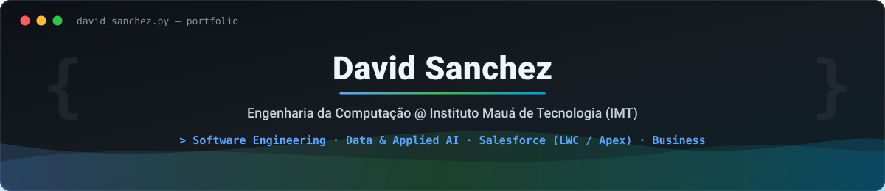
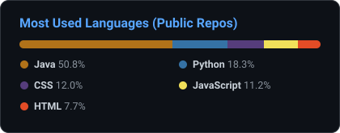

<p align="center">
  
</p>

<p align="center">
  <a href="https://www.linkedin.com/in/david-sanchez-bittencourt-daniel-071a422bb/"></a>
  
  
</p>

---

## 🚀 Sobre mim

```python
class DavidSanchez:
    def __init__(self):
        self.formacao = "Engenharia da Computação @ IMT (6º sem · dez/2028)"
        self.cargo_atual = "Estagiário Salesforce @ Orangedoor"
        self.experiencia_internacional = "Data Analyst Intern @ Plenumsoft (Mérida, México)"
        self.foco = [
            "Engenharia de Software (Python, Java, FastAPI)",
            "Dados & IA Aplicada (LLMs, RAG Híbrido, Vector Search, ML)",
            "Ecossistema Salesforce (LWC, Apex, CMS)",
            "Negócios & Estratégia Tecnológica",
        ]
        self.idiomas = {"PT-BR": "Nativo", "EN": "Fluente", "ES": "Fluente"}

    def missao(self) -> str:
        return "Transformar desafios complexos de negócio em arquitetura tecnológica de alto impacto."
```

## 💼 Experiência

| Empresa | Cargo | Destaques |
| :-- | :-- | :-- |
| **Orangedoor**<br><sub>set/2025 – atual</sub> | Estagiário | Ciclo completo no Salesforce: requisitos, protótipos, **LWC** e **Apex**. Atuação na arquitetura da nova intranet (**Salesforce CMS**), incluindo os módulos de Governança e Base de Conhecimento |
| **Mauá Júnior**<br><sub>set/2024 – jan/2026</sub> | Coordenador de Projetos de Tecnologia | Liderei o Núcleo de Tecnologia e criei os serviços **"Site em Código"** e **"Análise de Negócios com Machine Learning"**, que elevaram o ticket médio dos projetos |
| **Plenumsoft** 🇲🇽<br><sub>dez/2024 – fev/2025</sub> | Analista de Dados (estágio) | ETL de grandes volumes com **Python** e **SQL**, dashboards automatizados no **Dataiku DSS** e apoio a modelos preditivos para uma rede de lojas de conveniência |

## 🛠️ Projetos em destaque

| Projeto | Descrição | Stack |
| :-- | :-- | :-- |
| 🩺 [**MedSync**](https://github.com/DavidSanchezBD/MedSync) | Traduz laudos de exames laboratoriais (PDF) para uma linguagem leiga e personalizada. Usa uma arquitetura de **RAG híbrido** (índice determinístico, busca vetorial, parser de faixas por regex e LLM) para reduzir alucinações. <br><sub>*Projeto final do curso IA na Prática (IMT)*</sub> | FastAPI · OpenAI · ChromaDB · Pandas · PostgreSQL · JWT |
| 🐾 [**VetCore**](https://github.com/DavidSanchezBD/VetCore) | Sistema desktop de gestão de clínica veterinária: tutores, pacientes, consultas e prescrições, com integridade referencial no banco | Java 17 · JavaFX · MySQL · JDBC · MVC/DAO · Maven |

## 🧰 Tech Stack

**Linguagens**<br>


**IA & Dados**<br>


**Backend, Web & CRM**<br>


**Bancos de Dados & Ferramentas**<br>


## 📊 Linguagens mais usadas

<p align="center">
  
</p>

## 📜 Certificações

- **Engenharia de Sistemas Inteligentes: Integrando IA em Aplicações**, IMT (jul/2026)
- **Lean Six Sigma Green Belt**, IMT (dez/2025)

## 🌐 Idiomas

🇧🇷 Português (nativo) · 🇺🇸 Inglês (fluente) · 🇪🇸 Espanhol (fluente)

---

<details>
<summary>🇺🇸 <b>English version</b></summary>

<br>

### 🚀 About me

```python
class DavidSanchez:
    def __init__(self):
        self.education = "B.S. in Computer Engineering @ IMT (6th sem · Dec/2028)"
        self.current_role = "Salesforce Intern @ Orangedoor"
        self.international_exp = "Data Analyst Intern @ Plenumsoft (Mérida, Mexico)"
        self.focus = [
            "Software Engineering (Python, Java, FastAPI)",
            "Data & Applied AI (LLMs, Hybrid RAG, Vector Search, ML)",
            "Salesforce Ecosystem (LWC, Apex, CMS)",
            "Business & Technology Strategy",
        ]
        self.languages = {"PT-BR": "Native", "EN": "Fluent", "ES": "Fluent"}

    def mission(self) -> str:
        return "Turning complex business challenges into high-impact technical architecture."
```

### 💼 Experience

| Company | Role | Highlights |
| :-- | :-- | :-- |
| **Orangedoor**<br><sub>Sep/2025 – present</sub> | Intern | End-to-end Salesforce work: requirements, prototypes, **LWC** and **Apex**. Helped architect the company's new intranet (**Salesforce CMS**), including the Governance and Knowledge Base modules |
| **Mauá Júnior**<br><sub>Sep/2024 – Jan/2026</sub> | Technology Project Coordinator | Led the Technology Unit and created the **"Coded Websites"** and **"Business Analysis with Machine Learning"** services, which raised the average project value |
| **Plenumsoft** 🇲🇽<br><sub>Dec/2024 – Feb/2025</sub> | Data Analyst (intern) | Large-scale ETL with **Python** and **SQL**, automated dashboards in **Dataiku DSS** and support on predictive models for a convenience store chain |

### 🛠️ Featured projects

| Project | Description | Stack |
| :-- | :-- | :-- |
| 🩺 [**MedSync**](https://github.com/DavidSanchezBD/MedSync) | Translates lab test reports (PDF) into plain, personalized language. Uses a **hybrid RAG** architecture (deterministic index, vector search, regex range parser and LLM) to reduce hallucinations. <br><sub>*Final project of the IA na Prática (AI in Practice) course at IMT*</sub> | FastAPI · OpenAI · ChromaDB · Pandas · PostgreSQL · JWT |
| 🐾 [**VetCore**](https://github.com/DavidSanchezBD/VetCore) | Desktop management system for veterinary clinics: owners, patients, appointments and prescriptions, with referential integrity in the database | Java 17 · JavaFX · MySQL · JDBC · MVC/DAO · Maven |

### 🧰 Tech Stack

**Languages:** Python · Java · SQL · JavaScript<br>
**AI & Data:** Pandas · OpenAI API · ChromaDB · Machine Learning · Dataiku DSS<br>
**Backend, Web & CRM:** FastAPI · JavaFX · HTML5 · CSS · Salesforce (LWC, Apex, CMS)<br>
**Databases & Tools:** PostgreSQL · MySQL · Git · Maven

### 📜 Certifications

- **Intelligent Systems Engineering: Integrating AI into Applications**, IMT (Jul/2026)
- **Lean Six Sigma Green Belt**, IMT (Dec/2025)

### 🌐 Languages

🇧🇷 Portuguese (native) · 🇺🇸 English (fluent) · 🇪🇸 Spanish (fluent)

</details>
